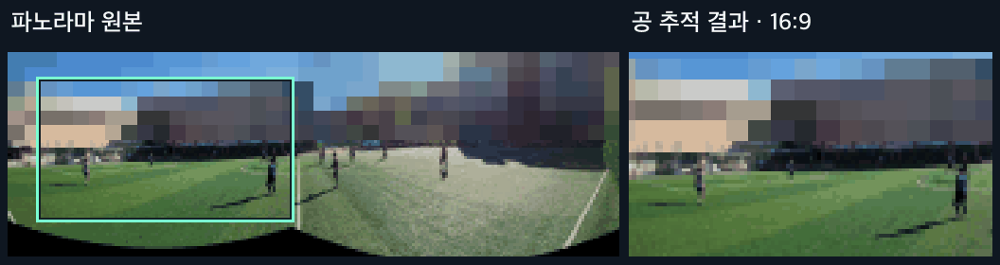

# Pitch Panorama Video Editing

두 카메라로 촬영한 영상을 정렬해 파노라마를 만들고, 필요에 따라 피사체를 따라가는 편집본을 만드는 작업 지침과 도구입니다.

## 예시로 공 추적 편집하기



왼쪽 파노라마의 테두리가 오른쪽 **16:9 공 추적 화면**에 해당합니다. 공이 오른쪽으로 넘어갈 때 테두리가 어떻게 따라가는지 보세요. 실제 경기의 같은 6초를 양쪽에 맞춰 재생하며, 양쪽 화면 전체에 모자이크를 적용했습니다.

### 합성 영상으로 직접 해 보기

아래 두 MP4는 연습용으로 만든 10초짜리 무음 영상입니다. 가상의 경기장에 선수와 공의 움직임을 합성해 같은 장면의 입력과 편집 결과를 비교할 수 있습니다.

| 파노라마 입력 | 공 추적 결과 |
| --- | --- |
| [전체 경기장 보기 · 1536×680](examples/panorama.mp4) | [16:9 편집본 보기 · 1280×720](examples/ball-follow.mp4) |

1. 이 저장소를 내려받아 Codex에서 폴더를 엽니다.
2. 아래 요청을 복사해 실행합니다.
3. `outputs/공추적-연습/`에 생성된 영상에서 5~7초의 긴 패스를 확인합니다. 공이 발을 떠난 뒤에도 화면이 공을 따라가고, 공 전체가 화면 안에 들어오는지 위 편집본과 비교하세요.

> `$pitch-panorama-video-editing` `examples/panorama.mp4`는 이미 스티칭한 파노라마야. 처음부터 끝까지 노란 공을 따라가는 16:9 영상으로 편집해 줘. 결과는 `outputs/공추적-연습/`에 저장해 줘.

자기 영상으로 작업할 때는 요청문의 입력 경로를 원본 파일이나 폴더 경로로 바꾸세요.

[공통 스티칭 절차](panorama/WORKFLOW.md)에서 시작합니다. 축구 경기는 [공 추적 편집 절차](panorama/FOOTBALL_WORKFLOW.md)를 함께 사용합니다. [촬영 양식](panorama/templates/job.json) 또는 [경기 양식](panorama/templates/match.json)을 `work/<작업명>/`에 복사한 뒤 그 사본에 촬영 정보를 입력하세요.

## 에이전트와 작업할 때

Codex에서 이 저장소를 열고 `$pitch-panorama-video-editing`과 함께 원본 위치와 원하는 결과를 적으세요. [저장소 스킬](.agents/skills/pitch-panorama-video-editing/SKILL.md)이 이 프로젝트의 가이드·설정·도구를 참조합니다.

> `$pitch-panorama-video-editing` 두 폴더에 나뉜 좌우 영상을 짝지어 쿼터별 공 추적 영상으로 편집해 줘. 경기 시작 전은 잘라 줘.

> `$pitch-panorama-video-editing` 이 파일은 이미 스티칭한 파노라마야. 공을 따라가는 16:9 영상으로 만들어 줘.

좌우 영상이 섞여 있으면 상위 폴더 하나를, 서로 다른 위치에 있으면 두 폴더를 그대로 지정하세요. 에이전트가 하위 폴더까지 확인해 어떤 파일끼리 짝이 맞고 어느 구간까지 함께 쓸 수 있는지 편집 전에 알려 줍니다. 한쪽 원본이 빠졌거나 후보를 구별하기 어려우면 해당 파일명과 확인 근거를 알려 주므로 필요한 원본을 추가하거나 그 구간을 제외할 수 있습니다.

에이전트가 남긴 작업 기록에서는 **어느 원본 시각이 출력 0초인지**, **어느 구간의 공을 직접 확인했는지**, **최종 영상에 어떤 잘림이 남았는지**를 확인할 수 있어야 합니다.

## 두 카메라의 접합부 확인

Python 3.10 이상과 NumPy, OpenCV가 필요합니다. 자세를 보정한 두 카메라에서 같은 시각의 프레임을 하나씩 선택하세요. 각 입력 프레임의 픽셀 좌표계에 맞게 추정한 3×3 내부 행렬 K와 카메라에서 공통 좌표계로 향하는 3×3 회전 행렬 R을 JSON에 넣습니다. 최상위 키는 `left`와 `right`이며 각 값은 `K`, `R` 두 행렬을 담은 객체입니다. 별도의 렌즈 왜곡 보정이 필요한 촬영은 프레임과 내부 행렬을 먼저 보정하세요.

```sh
python3 -m pip install numpy opencv-python
python3 panorama/tools/stitch_frames.py work/job/left.png work/job/right.png work/job/calibration.json work/job/preview.png
```

두 프레임을 원통면에 투영해 중첩부를 합성한 PNG가 생성됩니다. 고정 카메라를 처리하는 편집 스크립트에서는 `build_maps`를 한 번 호출하고 정렬된 각 프레임 쌍에 `blend_frames`를 적용할 수 있습니다. 카메라가 움직이거나 보정값이 달라지면 맵을 다시 계산하세요.

## 최종 오디오 확인

FFmpeg와 ffprobe를 PATH에 준비하고 SciPy를 설치하세요. 명령은 원본 음원과 최종 영상의 시작·중간·끝에서 소리를 비교합니다. `--source-start`에는 **최종 영상의 0초에 해당하는 원본 재생 시각**을 초 단위로 입력하세요. 아래의 0은 앞부분을 자르지 않은 예시입니다.

```sh
python3 -m pip install numpy scipy
python3 panorama/tools/verify_audio.py work/job/source.mp4 outputs/job/final.mp4 --source-start 0
```

검사 결과는 지연 시간과 상관계수를 표시합니다. 무음이거나 반복되는 소리라서 비교가 어려우면 `--at`으로 서로 다른 소리가 있는 구간을 지정하세요. 공 위치 판독, 구간별 화면 이동, 최종 렌더링은 촬영에 맞춰 로컬 편집 코드에서 수행합니다.
