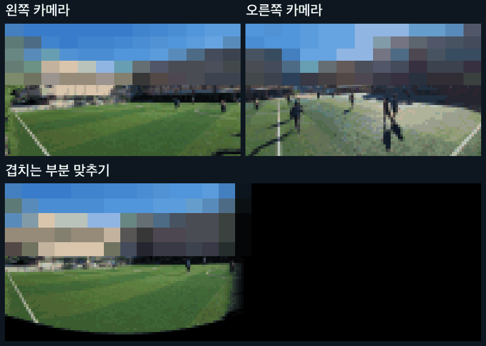

# Pitch Panorama Video Editing

두 카메라로 나눠 찍은 경기 영상을 하나의 넓은 화면으로 잇는 Codex 스킬입니다. 이 작업을 **스티칭**이라고 합니다. 이미 파노라마 영상이 있다면 공을 따라 화면이 움직이는 16:9 편집본을 만들 수 있습니다.

## Codex에서 사용하기

1. 이 저장소를 컴퓨터에 내려받으세요.
2. Codex에서 저장소 폴더를 여세요.
3. 아래에서 가지고 있는 영상에 맞는 요청문을 고르세요.
4. 예시 경로를 실제 파일이나 폴더 경로로 바꿔 Codex에 보내세요. 맨 앞의 `$pitch-panorama-video-editing`이 이 스킬을 지정합니다.

**좌우 카메라 영상이 있을 때** · 같은 시간에 찍었고 화면 일부가 겹치는 두 영상이 필요합니다. 두 카메라의 파일이 섞여 있으면 상위 폴더 하나를 지정해도 됩니다.

> $pitch-panorama-video-editing `촬영/왼쪽/`과 `촬영/오른쪽/`에서 같은 시간에 찍은 파일끼리 짝을 찾아 줘. 각 짝을 경기장 전체가 보이는 파노라마로 만들어 줘.

**파노라마 영상이 있을 때** · 원본 파일과 따라갈 대상을 지정하세요. 쿼터별 파일이 필요하면 요청에 적으세요.

> $pitch-panorama-video-editing `촬영/파노라마.mp4`에서 공을 따라가는 16:9 영상으로 편집해 줘. 경기 시작 전 대기 시간은 잘라 줘.

**기존 편집본을 고칠 때** · 편집본과 그때 사용한 파노라마를 함께 지정하세요. 문제를 본 시각은 편집본 기준으로 적으세요.

> $pitch-panorama-video-editing `편집/2쿼터.mp4`의 05:20부터 05:26까지 화면이 공 대신 축구화를 따라가. `촬영/2쿼터-파노라마.mp4`에서 공의 위치를 확인하고 그 구간만 고쳐 줘.

## 스티칭 결과 보기

위쪽은 두 카메라가 같은 장면을 찍은 정지 화면입니다. 아래쪽에서는 두 화면의 겹치는 부분을 맞춥니다. 이어서 경기장 전체를 담은 파노라마 영상이 재생됩니다.



<a id="예시로-공-추적-편집하기"></a>

## 공 추적 결과 보기

왼쪽 파노라마에서 테두리가 공을 따라 움직입니다. 오른쪽은 그 테두리 안을 확대한 16:9 편집본입니다. 공개 예시에서는 선수와 배경을 모두 모자이크로 가렸습니다.


## 편집이 끝나면

완성한 영상은 이 저장소의 `outputs/<작업명>/`에서 여세요. 원본 위치, 편집에 사용한 설정, 확인한 구간은 `work/<작업명>/`에 남습니다. 원본과 기존 편집본은 보존합니다.

완료 보고에서 파일별 길이와 **편집본의 0초에 해당하는 원본 시각**을 확인하세요. 공이 잘리거나 두 화면이 어긋나는 문제가 남으면 보고에 적힌 편집본 시각에서 해당 장면을 볼 수 있습니다.

## 도구를 직접 실행하려면

**두 화면이 만나는 부분 확인하기** · Python 3.10 이상에서 NumPy와 OpenCV를 설치하세요. 같은 시각의 좌우 프레임과 카메라 보정 파일을 준비하세요. 보정 파일은 JSON 형식입니다. `left`와 `right`에 각 프레임의 카메라 내부 행렬 `K`와 공통 좌표계로 향하는 회전 행렬 `R`을 넣으세요. 두 행렬은 각각 3×3입니다.

```sh
python3 -m pip install numpy opencv-python
python3 panorama/tools/stitch_frames.py work/job/left.png work/job/right.png work/job/calibration.json work/job/preview.png
```

`preview.png`를 열어 경기장 선과 선수가 겹치는 부분에서 자연스럽게 이어지는지 확인하세요. 촬영별 보정 방법은 [스티칭 절차](panorama/WORKFLOW.md)에 있습니다.

**소리가 원본과 맞는지 확인하기** · FFmpeg와 ffprobe를 설치하세요. `--source-start`에는 편집본의 첫 장면에 해당하는 원본 시각을 초 단위로 넣으세요. 아래 예시는 원본의 첫 12초를 잘라낸 경우입니다.

```sh
python3 -m pip install numpy scipy
python3 panorama/tools/verify_audio.py work/job/source.mp4 outputs/job/final.mp4 --source-start 12
```

도구는 편집본의 시작, 중간, 끝에서 원본과 소리를 비교합니다. 무음이나 반복음 때문에 비교하기 어려우면 `--at`으로 다른 구간의 시작 시각을 지정하세요. 공을 놓치거나 화면 가장자리에서 공이 잘리는 구간을 확인하는 방법은 [공 추적 편집 절차](panorama/FOOTBALL_WORKFLOW.md)에 있습니다.
